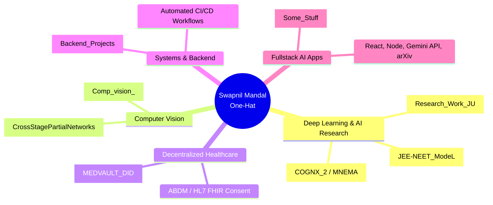

<div align="center">

# 🌐 Zerodha Landing Page Clone (Demo)

### *The Genesis Repository of Swapnil Mandal ([@One-Hat](https://github.com/One-Hat))*

[](https://github.com/One-Hat/Demo)
[](https://github.com/One-Hat/Demo/stargazers)
[](LICENSE)
[](https://developer.mozilla.org/en-US/docs/Web/HTML)
[](https://developer.mozilla.org/en-US/docs/Web/CSS)
[](https://developer.mozilla.org/en-US/docs/Web/JavaScript)

<p align="center">
  A clean, modern, responsive landing page clone inspired by Zerodha's investment platform UI.
</p>

[Live Demo](#quick-start) • [Features](#key-features) • [Developer Journey Briefing](#briefing-swapnils-github-engineering-journey) • [Author](#author)

---

</div>

## 📌 About This Repository

Created on **July 9, 2025**, this repository marks the foundational milestone in Swapnil Mandal's development journey — his very first Git repository and first step into web development and version control.

Originally an introductory HTML layout experiment, the project has been modernized into a clean, standards-compliant, responsive single-page landing application showcasing modern CSS layout principles, semantic HTML5, and accessible UI interactions.

---

## ✨ Key Features

- **🎯 Zerodha Minimalist Aesthetic**: Clean typography, structured whitespace, and Zerodha's signature blue palette (`#387ed1`).
- **📱 Fully Responsive**: Fluid multi-breakpoint layout supporting mobile, tablet, and desktop viewports with an adaptive hamburger navigation menu.
- **⚡ Zero Dependencies**: Pure HTML5, CSS3, and vanilla JavaScript for ultra-fast load times and instantaneous rendering.
- **💬 Interactive Lead Modal**: Accessible modal overlay for account signup with ESC key and backdrop-dismiss handling.
- **📊 Modern Showcase Sections**:
  - Hero banner with vector branding and platform illustration
  - Transparent pricing & ecosystem metric counters (`₹0 brokerage`, `1.5+ Cr clients`)
  - Product feature grid with cards and subtle micro-interactions
  - Comprehensive footer navigation and regulatory disclaimer formatting

---

## 🚀 Quick Start

No build tools or package managers required. Simply clone and open:

```bash
# 1. Clone the repository
git clone https://github.com/One-Hat/Demo.git

# 2. Navigate into the directory
cd Demo

# 3. Open index.html directly in your browser:
# On Windows:
start index.html

# On macOS:
open index.html

# Or run with any static server:
npx serve .
```

---

## 🗺️ Repository Structure

```text
Demo/
├── index.html        # Modernized semantic HTML5 & responsive stylesheet
├── landing.png       # Zerodha platform ecosystem illustration
├── logo.svg          # Zerodha SVG vector brand logo
└── README.md         # Documentation & GitHub journey overview
```

---

## 🌟 Briefing: Swapnil's GitHub Engineering Journey

Since committing this initial `Demo` repository, Swapnil Mandal ([@One-Hat](https://github.com/One-Hat)) has built an expansive portfolio across **AI & Deep Learning research**, **continual learning systems**, **decentralized identity (Web3)**, **backend architecture**, and **fullstack web applications**.

Here is an architectural briefing of key repositories and domains:



### 1. 🧠 Frontier AI & Deep Learning Research
- **[Research_Work_JU](https://github.com/One-Hat/Research_Work_JU)**:
  * *Adaptive Reinforcement Learning Fusion for Hybrid Vision Architectures* (Jadavpur University collaborative research).
  * Implements an adaptive, per-class Reinforcement Learning policy agent combining the complementary inductive biases of CNNs (ConvNeXt/ResNet) and Vision Transformers (Swin Transformer).
  * Includes end-to-end PyTorch notebooks, LaTeX research manuscript (`main.tex`), Grad-CAM vs. Swin attention calibration plots, and BibTeX citations.
- **[COGNX_2 (MNEMA)](https://github.com/One-Hat/COGNX_2)**:
  * *Memory-Native Event-Driven Architecture for Edge Continual Learning*.
  * Research codebase benchmarked with `uv`, featuring event-driven memory buffers designed to prevent catastrophic forgetting on resource-constrained edge hardware.
- **[JEE-NEET_ModeL](https://github.com/One-Hat/JEE-NEET_ModeL)**:
  * LoRA fine-tuned Google Gemma-2B-IT model specialized in generating and solving complex STEM questions for competitive examinations (JEE Advanced & NEET). Includes Safetensors adapter weights and custom Jinja chat templates.

### 2. 🛡️ Decentralized Healthcare & Identity (Web3)
- **[MEDVAULT_DID](https://github.com/One-Hat/MEDVAULT_DID)**:
  * Decentralized identity and verifiable consent platform for healthcare.
  * Engineered with **Next.js**, **Web Crypto API** (NIST P-256 / AES-GCM), **Hyperledger Aries pairwise `did:peer`**, and **ABDM / HL7 FHIR** standards.
  * Implements AnonCreds Zero-Knowledge Proof (ZKP) predicate proofs to eliminate centralized patient data honeypots and prevent insurance fraud.

### 3. ⚡ Scalable Backend & Distributed Systems
- **[Backend_Projects](https://github.com/One-Hat/Backend_Projects)**:
  * Production-grade Node.js/TypeScript backend portfolio with automated GitHub Actions CI/CD.
  * Projects include a high-concurrency URL Shortener (Redis caching, rate-limiting, MongoDB) and a Headless CMS with role-based access control (RBAC).

### 4. 🌐 Fullstack AI Applications
- **[Some_Stuff (PaperTrail — AI Research Explorer)](https://github.com/One-Hat/Some_Stuff)**:
  * Fullstack academic research intelligence platform built with React, Vite, Tailwind CSS, Express, MongoDB, Google Gemini API, and arXiv API integration.
  * Supports preprint exploration, multi-turn AI paper analysis, reading lists, and BibTeX citation export.

### 5. 👁️ Computer Vision & Perception
- **[Comp_vision_](https://github.com/One-Hat/Comp_vision_)**:
  * Real-time object detection and multi-object tracking pipelines featuring YOLOv9, ByteTrack, and DeepSORT implementations.

---

## 👨‍💻 Author

**Swapnil Mandal**  
- **GitHub**: [@One-Hat](https://github.com/One-Hat)  
- **Bio**: *"Recursive learner, always refactoring what I know. Compiling curiosity into code. Always debugging my own assumptions ~ one commit at a time :)"*

---

## 📄 License

This demo project is open source and available under the [MIT License](LICENSE).
